<div align="center">

# AntelopeJS DMS template

**Start your own back office on your PostgreSQL, MongoDB or RethinkDB database, with the Builder and the AI assistant.**

[AntelopeJS DMS](https://github.com/AntelopeJS/dms) · [Docs](https://dms.antelopejs.com/docs) · [Discord](https://discord.gg/g4pFt6eXqu)

<a href="https://github.com/AntelopeJS/dms"></a> <a href="https://discord.gg/g4pFt6eXqu"></a>

</div>

The starting point for your own project with [AntelopeJS DMS](https://github.com/AntelopeJS/dms). It runs the DMS with the Builder and the AI assistant, and nothing else: no sample data, no demo application, no seeded database.

Want to try it on sample data first? Use [`template-dms-connect-demo`](https://github.com/AntelopeJS/template-dms-connect-demo).

## Run with Docker

You need git, Node.js 24, and Docker with Compose v2.

```bash
npx @antelopejs/core project init my-project --template dms-starter
cd my-project
docker compose up
```

When the log prints `Local: http://localhost:3001/`, open the onboarding address from the `dms` log and create the administrator account. See [First run](#first-run). The DMS keeps its own data in the MongoDB that `compose.yaml` starts.

## First run

There are no default credentials. When no administrator exists, the backend prints the address of the setup wizard at start. With Docker, it is in the `dms` log. Without Docker, it is in the `pnpm dev` terminal:

```
[DMS] No owner exists yet. To create it, open http://localhost:3001/onboarding?token=...
```

Open that address and create the administrator account. The wizard reads the setup token from the address. If you set `DMS_SETUP_TOKEN`, the log shows `<DMS_SETUP_TOKEN>` in place of the token, and you use your own value.

## Connect your own database

In the assistant's onboarding popup, choose **Start from an existing database** and paste a PostgreSQL, MongoDB, or RethinkDB connection URL. The URL is saved in this project's `.env`. Access is **Read only** by default: the DMS reads the schema and the rows and writes nothing. Choose **Read and write** only if you want to edit rows from the DMS. After the analysis, untick the tables you don't need, then choose **Generate a first mockup** or **Build directly**. The assistant writes a TypeScript page for each table you keep, in this repository.

Without Docker, use `localhost` as the host of a database on your machine. With Docker, the DMS runs in a container. Use `host.docker.internal` as the host to reach a database on your machine. To reach a database in another container, put it on the same Compose network and use its service name.

To try the Connect flow on a sample database first, use [`AntelopeJS/template-dms-connect-demo`](https://github.com/AntelopeJS/template-dms-connect-demo).

## Build pages

Pages start as a mockup. Describe what you need to the assistant, or choose **Start from scratch** in the onboarding popup, and the assistant drafts a mockup of real DMS blocks. To rework a page that already exists, press **Edit as mockup**, the pencil in the dashboard header. The mockup has two modes:

- **Comment** mode. Click a block to leave a note on it for the assistant.
- **Edit** mode. Add blocks from the catalog, move, duplicate, delete, and restyle them, and edit texts and pages in place.

When the mockup is right, press **Build it**. The assistant writes the pages as TypeScript in this repository, which you can edit and commit.

## AI assistant

The assistant in the dashboard runs a coding agent in this project's folder, Claude Code or Codex, on your own subscription. Open the chat with the sparkle icon in the header, or press `Ctrl` `Shift` `K`. Its settings are under **Modules** > **Assistant**.

**Without Docker.** The assistant runs as you, on your machine, so it uses the logins you already have. You set no token and no API key.

- **Claude Code.** If you are signed in to Claude Code on this machine, the assistant uses that login. If you are not, run `claude` once and sign in. The assistant runs the copy of Claude Code that `@antelopejs/dms-ai` installs, so it needs no `claude` on your `PATH`.
- **Codex.** This project has `@openai/codex` 0.154.0 as a dependency, so you install nothing more. The assistant does not read a `codex login` from your terminal. Open **Assistant** > **Settings** and press **Sign in with ChatGPT** once. The sign-in is stored in `~/.config/dms-ai` and serves every DMS project on your machine.

**With Docker.** The assistant runs inside the container, which has none of your logins. Give the container one of these before `docker compose up`:

- **Claude Code with your Claude subscription.** On your machine, run `claude setup-token` and put the token in a `.env` file next to `compose.yaml`:

  ```bash
  CLAUDE_CODE_OAUTH_TOKEN=sk-ant-oat01-...
  ```

- **Codex with your ChatGPT plan.** Open **Assistant** > **Settings** and press **Sign in with ChatGPT**. The page that OpenAI sends you back to does not load, because the assistant is in the container. Copy its address from the address bar and press **Paste the return address**.
- **An Anthropic API key**, if you prefer one. Put `ANTHROPIC_API_KEY=sk-ant-...` in the same `.env` file.

<a href="https://github.com/AntelopeJS/dms"></a>

## More

<details>
<summary><b>Run without Docker</b></summary>

### Run without Docker

You need git, Node.js 24, pnpm 10.2.0, and a MongoDB server. The DMS keeps its own data in that MongoDB.

- Node.js 24 is the version in `.nvmrc`.
- pnpm 10.2.0 is the version that `packageManager` in `package.json` pins. Node.js 24 includes corepack, and `corepack enable` makes the `pnpm` command use that version.

Create the project. The command installs its packages:

```bash
corepack enable
npx @antelopejs/core project init my-project --template dms-starter
cd my-project
```

If you have no MongoDB on `localhost:27017`, start one. This is the only container you need:

```bash
docker run -d --name dms-mongo -p 127.0.0.1:27017:27017 -v dms-mongo:/data/db mongo:8
```

If your MongoDB listens elsewhere, set `MONGODB_URL` when you start the backend, for example `MONGODB_URL=mongodb://localhost:27018 pnpm dev`.

Run the backend and the dashboard in two terminals. In the first terminal, start the backend:

```bash
pnpm dev
```

Wait until the log prints `Constructed modules`. In the second terminal, start the dashboard:

```bash
pnpm frontend:dev
```

When the log prints `Local: http://localhost:3001/`, open the onboarding address from the `pnpm dev` terminal and create the administrator account. See [First run](#first-run). Press `Ctrl` `C` in each terminal to stop. Your data stays in MongoDB.

</details>

## Documentation

- [DMS documentation](https://dms.antelopejs.com/docs)
- [AntelopeJS framework](https://github.com/AntelopeJS/antelopejs)
- [Discord](https://discord.gg/g4pFt6eXqu)

## Licence

[Apache-2.0](LICENSE)
